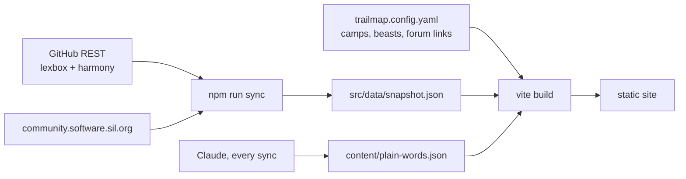

# Trailmap

A progress map for the FW Lite team, made for three readers at once:

- **Stakeholders** see how close FieldWorks Lite 1.0 is, what's left, and where the team's time actually goes, in plain words.
- **The team** gets a short, concrete list per camp and a "we're here" marker that moves as issues close.
- **Everyone** gets something to cheer: wanted posters for the long, hard bugs, a field journal of what shipped each week, and patches the team earns together.

Forum feature requests show up too, with their votes and whether they're shipped, on the road to 1.0, tracked for later, or not scheduled yet.

## How it works



- `trailmap.config.yaml` is the one file people edit: the summit milestone, camps (themed groups of issues, in walking order), the Harmony goals, the beasts, and which forum topics map to which issues. Milestone issues not in any camp land in a "Still to sort" camp, so nothing silently drops off the map.
- `npm run sync` uses only the REST API (about 80 requests), so the Actions `GITHUB_TOKEN` is plenty.
- `content/plain-words.json` holds a plain-language title and an area for each item, plus the GitHub title it was written for, so `npm run plain:todo` can tell when one is missing or stale. `AGENTS.md` has the rules an agent follows to fill it.
- Progress is counted, never estimated: a camp is closed issues over all issues (dropped ones don't count). A beast's poster lights steps from GitHub signals (open PR, merged PR, closed issue) plus a hand-set `causeFound`. Nothing on the page shows a date it can't back up.
- Trophies are for the whole team. There are no per-person scores on purpose.

## Run it

```sh
npm ci
npm run sync        # needs network; set GITHUB_TOKEN for higher rate limits
npm run dev
npm run build       # dist/ for GitHub Pages
npm run build:single  # dist-single/index.html with everything inlined
```

## Hosting

`.github/workflows/publish.yaml` runs every 6 hours: it syncs, asks Claude for plain titles for any new items and commits them to main, then deploys to GitHub Pages. Claude needs a `CLAUDE_CODE_OAUTH_TOKEN` secret (from `claude setup-token`) in the `claude` environment, which only `main` can use.
